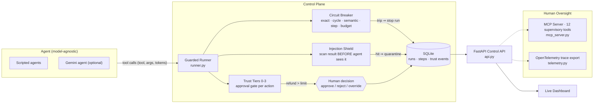

# 🛡️ AgentOps Guardian — Earned Autonomy for AI Agents

<p align="center">
  <a href="https://agentops-guardian.onrender.com"><b>Live Demo</b></a> ·
  <a href="https://agentops-guardian.onrender.com/docs">API Docs</a> ·
  <a href="eval/results.md">Benchmark Results</a> ·
  <a href="#mcp-server">MCP Server</a> ·
  <a href="#-honest-limits">Honest Limits</a>
</p>


**Companies will not let AI agents act on their own, because one loop can burn the budget and one poisoned email can trigger a $5,000 refund.
This project is a control layer that stops bad runs and lets each agent earn its permissions, like a credit score.**

> **One line:** *an agent's permissions grow and shrink automatically with its measured track record — and a breaker, shield and human gate sit between it and the tools regardless of which LLM it uses.*

Built for the International AI Builders Congress 2026, InfraSphere AI, AgentOps challenge — *"Reliable, governable agent systems" (MCP + observability + evaluation)*.

## How it works



The agent never sees the tool result raw and never acts unprompted above its tier: every step passes the breaker, the approval gate and the shield, and every outcome writes an insert-only trust event with a plain-English reason.

## What it does

| Layer | What it does |
|---|---|
| **Circuit breaker** | Stops a run on: exact repeats, 3-4 step cycles, reworded loops (semantic), a step limit, or a budget cap |
| **Trust score + tiers** | Every agent starts at 50. Good runs raise it, trips, kills and attacks lower it. The score sets what the agent may do without asking a human |
| **Injection shield** | Scans every tool result for hidden instructions *before* the agent sees it. A hit quarantines the run and costs trust |
| **Human control** | Pause, resume, kill, approve, reject, edit the agent's memory, override its next tool call — from the dashboard, the REST API or MCP |
| **Dashboard** | Live runs, trust scores with reasons, approvals and one-click scenarios (open `/`) |
| **MCP server** | The same controls as MCP tools for Claude Desktop, Cursor or MCP Inspector (`mcp_server.py`) |
| **OpenTelemetry** | Each run is a trace and each step a span, for Phoenix, Jaeger or any OTLP collector |
| **Real LLM agent** | A Gemini agent using the same tools (needs a free API key; see limits) |

### Trust tiers

| Tier | Score | May do without asking a human |
|---|---|---|
| 0 Probation | below 30 | nothing: every action needs approval |
| 1 Junior | 30-59 | lookups and emails; any refund needs approval |
| 2 Trusted | 60-79 | refunds up to $100 |
| 3 Senior | 80-100 | refunds up to $500 |

Score changes: run completed +8, action approved +2, action rejected -5, killed by a human -10, breaker tripped -15, injection caught -20.
Trust is slow to earn and quick to lose: one trip (-15) needs two clean runs (+16) to win back. These are starting values, not tuned on real agents.

## Quickstart

```bash
git clone https://github.com/ShaswataBarua/agentops-guardian.git
cd agentops-guardian
pip install -r requirements.txt
python -m pytest -q               # 62 tests
python demo.py                    # no server: shows the cost saving
uvicorn api:app --reload          # dashboard at http://localhost:8000, API docs at /docs
```

Optional: `.env` with `GEMINI_API_KEY=...` for the real-LLM scenario. Run `python llm_smoke.py` first (see limits).
Free public deployment: see `DEPLOY.md`. Traces: see the OpenTelemetry section below.

## Results (measured by `python eval/compare.py`)

| Loop detector | Loops caught | False alarms on normal work |
|---|---|---|
| Exact-repeat rule only | 3/8 | 0/7 |
| + cycle rule | 4/8 | 0/7 |
| + semantic rule (full) | **7/8** | 0/7 |

Injection shield: **8/12** attacks caught, 0/10 harmless messages flagged.
Cost demo (`demo.py`): a looping agent uses 80,000 tokens ($0.24 at a placeholder $3 per 1M tokens) without the breaker and 4,000 ($0.012) with it, a 95% saving on that run.

## MCP server (12 supervisory tools)

>`SECURITY`: give this server to the **human supervisor's** client, never to the agent being supervised. It exposes **no tool that sets a trust score** — trust is earned from events, never handed out.

| Tool | What a supervisor's client can do |
|---|---|
| `get_policy` / `list_agents` / `get_agent_trust` / `list_runs` / `get_run` | Read the rules and every agent's score, tier, run-step and trust history |
| `pause_run` / `resume_run` / `kill_run` | Freeze, continue or terminate a live run |
| `approve_action` / `reject_action` | Answer the human-approval gate from an MCP client |
| `edit_run_memory` / `override_tool_call` | Correct an agent mid-run: change its memory, replace its next tool call |

```bash
uvicorn api:app                                   # start the API
python mcp_server.py                              # stdio transport
npx @modelcontextprotocol/inspector python mcp_server.py   # inspect it
AGENTOPS_URL=https://agentops-guardian.onrender.com python mcp_server.py  # supervise a remote host
```

## OpenTelemetry traces (open standard)

Every run becomes one trace and every step one span (tool, tokens, cost, status, trust score). It is off until you give it a collector address.

```bash
pip install arize-phoenix            # free, open-source viewer
phoenix serve                        # UI at http://localhost:6006
set OTEL_EXPORTER_OTLP_ENDPOINT=http://localhost:6006      # Mac/Linux: export ...
uvicorn api:app
```
A tripped, killed or quarantined run shows as an error span with the stop reason.

## Honest limits (read before you trust any number above)

- **The test sequences and attack messages were written by the detector's author.** The scores are optimistic and say nothing about real-world accuracy.
- **Semantic detection uses a small hand-made synonym table**, not a sentence-embedding model. It misses the reworded policy question and anything outside its word list. Swapping in real embeddings means replacing two functions in `semantic.py`; that upgrade is not built or tested.
- **The shield is rule-based.** It missed 4 of 12 attacks (leetspeak, an authority claim, a French attack, a polite rewording). Defence in depth: even if it misses, the trust tiers hold big refunds for a human.
- **The Gemini agent is not tested against the live API.** The code around it is tested with fake responses. Run `python llm_smoke.py` and fix the model name or fields if it fails.
- **Cycles longer than 4 steps are not detected.** The step limit and budget cap are the backstop.
- **Token prices are placeholders** (`PRICE_PER_M` in `runner.py`). Free tiers cost $0; the price shows the value to a paying company.
- Scripted agents are simulations. The trust score has not been tested on agents in production.

## Files

| File | Job |
|---|---|
| `breaker.py` | Loop, cycle, step-limit and budget rules |
| `semantic.py` | Reworded-loop detection (entities + intent concepts) |
| `shield.py` | Prompt-injection rules |
| `trust.py` | Score rules, tiers, approval policy, plain-English explanation |
| `runner.py` | Runs one agent: control gate, breaker, tiers, shield, logging |
| `agents.py` | Fake shop tools and scripted scenarios |
| `llm_agent.py` | Gemini-backed agent (untested live) |
| `store.py` | SQLite: runs, steps, trust events |
| `api.py` | FastAPI control, trust and dashboard routes |
| `dashboard.html` | The live dashboard |
| `mcp_server.py` | MCP tools for a human supervisor's client |
| `telemetry.py` | OpenTelemetry export |
| `seed_demo.py`, `Dockerfile`, `DEPLOY.md` | Free public deployment |
| `eval/compare.py` | Measures the detectors (writes `eval/results.md`) |
| `tests/` | 62 tests |

**MCP security note:** give the MCP server to the human supervisor only, never to the agent being supervised. It can approve actions and kill runs, and it deliberately has no tool that sets a trust score.

## Reproduce the numbers

```bash
python eval/compare.py        # writes eval/results.md: detector A/B/C comparison + attack table
python -m pytest -q           # 62 tests: breaker rules, semantic rule, shield, trust tiers, approvals, MCP, seeding
python llm_smoke.py           # optional: verify the Gemini runtime path against the live API
```

## Roadmap

- [ ] Swap the synonym table for a sentence-embedding model (two functions in `semantic.py`)
- [ ] Embedding-grade injection shield with adversarial test set
- [ ] Adapters: emit `(tool, args, tokens)` from LangGraph / CrewAI runs into the same governed loop
- [ ] Replay a recorded run under a stricter/lighter trust policy
- [ ] Calibrate trust deltas against historical agent performance data

## License

[MIT](LICENSE) — free to use, fork and build on. If it inspires your governance layer, a link back is appreciated.
